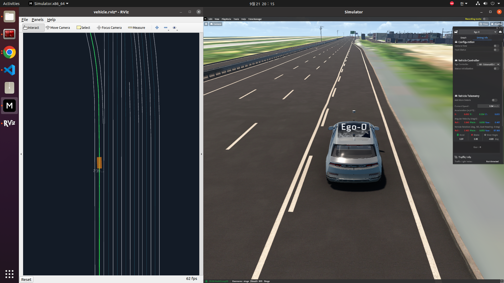
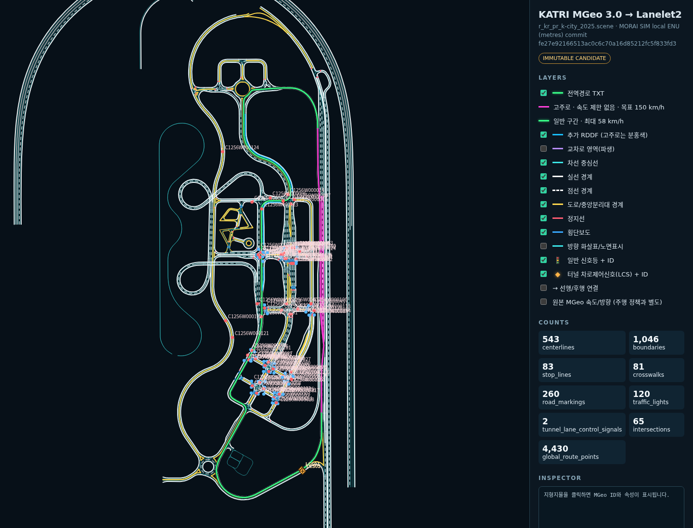
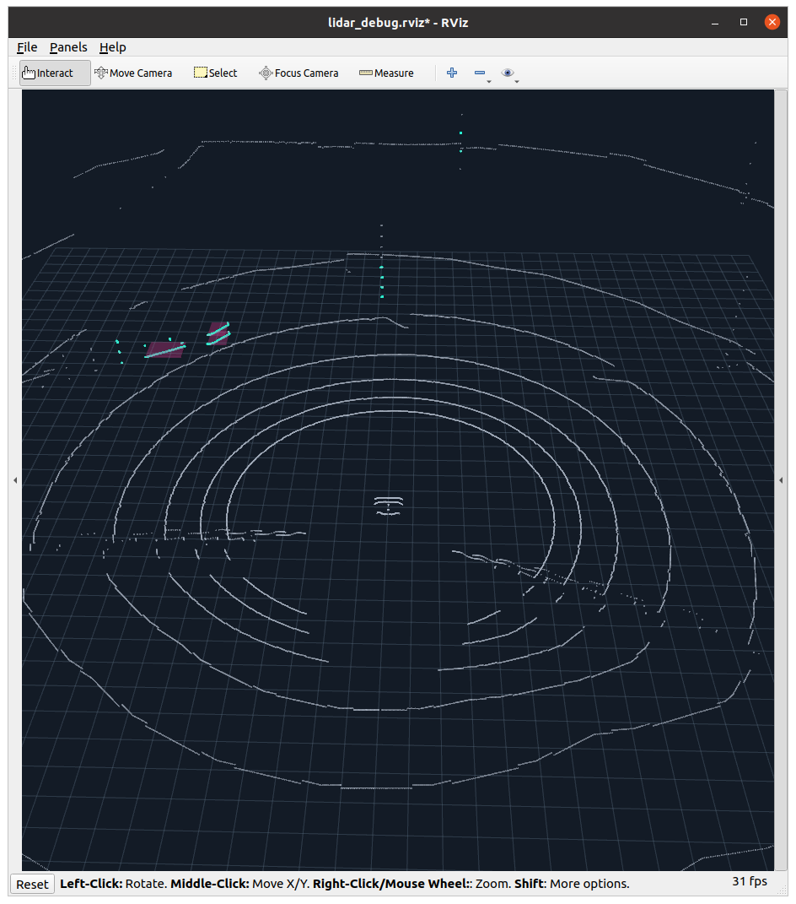
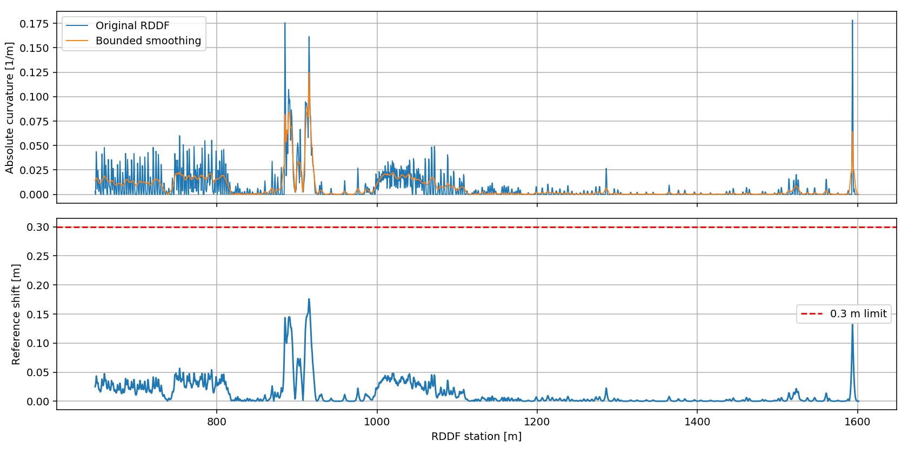

# MORAI Autonomous Driving · Personal Contribution Portfolio

- **구현 방식:** ROS1 기반 모듈형 자율주행 시스템에서 중앙 인터페이스·TF·시간 계약, HD맵·RDDF, 센서 처리와 Frenet 경로 생성 파이프라인을 설계·구현·통합했습니다.
- **수행 내용:** 위치 재배치 복구, LiDAR 자세·지면 보정, 지도 좌표계 객체 추적, 경로 연결·평활화, 계획 갱신·주행 파라미터 조정과 RViz 진단을 수행했습니다.
- **핵심 역량:** 지도·센서·위치·경로·제어 사이의 연결 문제를 커밋·rosbag·실행 화면으로 추적하고, 알고리즘 변경과 통합 검증을 함께 진행했습니다.

> **CV·자기소개용 PR 포트폴리오**입니다. Team-Stier의 MORAI 자율주행 프로젝트에서 **백승민(`simonpaik04`)이 수행한 구현·수정·통합 작업**을 소개합니다. 기여별 원본 코드와 커밋은 아래에서 확인할 수 있습니다.

*2026-09-21 개발 실행 화면. 왼쪽은 지도·경로·차량 위치를 표시하는 RViz, 오른쪽은 MORAI 차량 화면입니다. 당시 전역경로 추종 구성이며, 이후 Frenet·터널 보정의 실행 결과를 나타내는 캡처는 아닙니다.*

**ROS1 Noetic · C++ · Python · MORAI UDP · MGeo/Lanelet2 · EKF · PCL/DBSCAN · Frenet · RViz**

[기여 요약](#내가-담당한-작업) · [문제 해결 사례](#대표적인-문제-해결) · [실행·분석 자료](#실행분석-자료) · [기여 근거](docs/CONTRIBUTIONS.md) · [자료 출처](docs/PROVENANCE.md)

## 프로젝트와 나의 역할

2026 대학생 AI/SW 모빌리티 경진대회를 준비하는 **Team-Stier의 MORAI 시뮬레이터 기반 자율주행 팀 프로젝트**입니다. 차량의 위치와 주변 객체를 추정하고 지도 경로를 연결해 제어기로 전달하는 과정에서, 여러 모듈이 일관된 좌표·시각·메시지를 사용하도록 구성하는 작업에 참여했습니다.

저의 기여는 **시스템 아키텍처와 인터페이스 정리, HD맵·경로 처리, 위치 추정 개선, LiDAR 처리·추적, Frenet 경로 생성 및 주행 통합**에 걸쳐 있습니다. 기존 팀 검출 코드와 외부 제어 코어를 활용한 부분에서는 ROS 인터페이스 연결, 전처리 개선과 통합 검증을 담당했습니다.

## 내가 담당한 작업

| 분야 | 수행한 작업 | 기여의 의미 |
| --- | --- | --- |
| **시스템 아키텍처** | 패키지 책임 분리, 중앙 ROS 메시지·토픽 계약, TF·측정시각 정책, MORAI UDP 브리지와 통합 실행 구성 | 센서부터 최종 명령까지 모듈 간 연결 기준 마련 |
| **HD Map·RDDF** | KATRI MGeo 기반 Lanelet2 변환·뷰어, 차로 RDDF 추출·연결, 체크포인트·신호 정지선 표시, CP11 합류 수정 | 지도 데이터를 경로 생성과 디버깅에 사용할 수 있도록 연결 |
| **위치 추정** | 기존 localization 통합, GPS·IMU 연속 관측을 이용한 재배치 복구, 위치 오차에 따른 재초기화 | 시뮬레이터에서 차량을 재배치했을 때 위치 추정 복구 지원 |
| **LiDAR 전처리** | 측정시각 자세 보간·roll/pitch 수평화, 자차 반사점 제외, 구역별 지면 제거, ROI·DBSCAN 연결 | 차체 기울기·지면·자차 점이 장애물 처리에 미치는 영향 완화 |
| **객체 추적** | scan-time TF로 map 변환, 지속 track ID·수명 관리, 연속 클러스터 점군 정합을 이용한 속도 추정 | 프레임별 관측을 시간적으로 연결해 Planner 입력 구성 |
| **Frenet·주행 통합** | RDDF 유지·합류·차로변경 후보, 충돌 평가 계산 정리, 활성·대기 경로 관리, 기준 경로 평활화, 제어 코어 연결·속도 튜닝 | 계획 결과와 제어기 사이의 경로 연속성 및 응답 개선 작업 |
| **시각화·검증** | RViz 지도·차량·객체·경로·플래너 상태 표시, rosbag 분석, 계약·회귀 테스트 | 모듈 상태와 문제 원인을 실행 자료로 확인할 수 있도록 구성 |

## 대표적인 문제 해결

### 1. 제동·차체 기울기에 따른 LiDAR 처리 변화

차체 roll·pitch가 변하면 센서 좌표계의 지면 높이가 달라져 ROI와 군집 결과에도 영향을 줍니다. 기존 오프라인 수평화의 회전식을 **실시간 C++ 전처리로 이식**하고, LiDAR 측정시각의 차량 자세를 quaternion SLERP로 보간했습니다. 수평 좌표에서 지면 제거·ROI·군집화를 수행한 뒤 출력은 원래 센서 좌표와 측정시각을 보존하도록 연결했습니다.

**확인한 결과:** 2026-09-14 MORAI 10초 수신 기록에서 raw·filtered·observation을 각각 73개 수신했습니다. 이는 처리 경로의 동작 확인이며 객체 검출 정확도 측정은 아닙니다.

[수평화 변경 커밋](https://github.com/Team-Stier/Morai_Sim_team2/commit/ecc0503) · [지면 제거 커밋](https://github.com/Team-Stier/Morai_Sim_team2/commit/e9fae2d) · [실행 기록](docs/lidar-runtime-audit.json)

### 2. 경로를 갱신하거나 차량을 재배치할 때 생기는 불연속

새 계획을 기다리는 동안 경로가 끊기거나, 발행 경로의 첫 점을 매번 차량 위치로 덮어쓰면 제어기가 실제 횡오차를 읽기 어렵습니다. **선택 경로의 형상·접선을 보존**하고, 기존 활성 경로와 최신 대기 결과를 관리하도록 수정했습니다. 위치 추정의 `reset_id`가 바뀌면 이전 경로와 계산 결과를 폐기하도록 연결했습니다.

**확인한 결과:** 회귀 테스트와 통합 기록으로 경로 형상·reset 처리를 확인했습니다. 변경별 주행 효과와 한계는 원본 [Frenet 검증 문서](https://github.com/Team-Stier/Morai_Sim_team2/blob/42fdefa812747820b635231a0ab36845d58cdb7e/src/path_planning_pkg/docs/frenet_rddf.md)에 기록되어 있습니다.

[경로 발행 수정](https://github.com/Team-Stier/Morai_Sim_team2/commit/6ecdc5a) · [최소 유지·최신 결과 적용](https://github.com/Team-Stier/Morai_Sim_team2/commit/f325c70)

### 3. RDDF의 작은 꺾임이 곡률 계산에 미치는 영향

원본 RDDF의 작은 꺾임을 station 기반 Gaussian 평균으로 완화하고, 원본 대비 이동량에 상한을 두었습니다. **현재 반영 설정은 기준 경로 평활화 이동 상한 0.15 m**입니다. 경로 평활화 이후에도 후보의 충돌·조향·곡률 기반 속도 검사를 유지했습니다.

**확인한 결과:** 이전 0.30 m 상한 실험에서 기록된 고속 구간의 최대 절대 곡률이 **0.1784 → 0.0643 /m**로 줄었습니다. 오프라인 경로 비교 결과이며, 현재 0.15 m 설정의 수치나 실제 주행·제동 개선률을 뜻하지 않습니다.

[평활화 구현](https://github.com/Team-Stier/Morai_Sim_team2/commit/b4e650d) · [15 cm 상한 변경](https://github.com/Team-Stier/Morai_Sim_team2/commit/cbcd937) · [실험 수치](docs/rddf-smoothing-experiment.json)

### 4. GPS 음영 터널에서의 LiDAR 벽 보정

지도에서 터널 벽선을 추출하고 LiDAR 양쪽 벽 정합을 위치 추정기에 연결했습니다. 이 작업은 검토 기준 시점에 **`paik` 브랜치에 있으며 팀 `main`에는 미반영**입니다. 벽 정합은 횡방향 보정을 지원하지만 터널 진행방향 이동을 충분히 관측하지 못합니다.

**확인한 결과:** 벽 정합 연결과 횡보정 진단을 확인했습니다. 진행방향 drift와 유효성 제한이 남아 **터널 전체 위치 유지·완주 성공으로 표현하지 않습니다**.

[벽 정합 연결](https://github.com/Team-Stier/Morai_Sim_team2/commit/a06cbe4) · [통합 검증 기록](https://github.com/Team-Stier/Morai_Sim_team2/blob/45ded67d34008c57b43f793ce3825c29f32e5d66/src/localization_pkg/docs/tunnel_wall_matching.md)

## 실행·분석 자료

### HD Map·RDDF 미리보기

*MGeo 지도 레이어·전역경로·추가 RDDF를 함께 표시한 개발 자료입니다. 화면의 목표 속도는 당시 개발 설정으로, 실제 달성 속도나 대회 규정 준수 결과가 아닙니다.*

### LiDAR 처리 실행 화면

*2026-09-14 기존 실행 캡처. 검출 전처리에 수평화를 적용하되 출력 frame은 `lidar_link`로 유지하므로, 센서 좌표 화면에서 지면이 기울어 보일 수 있습니다.*

### RDDF 평활화 분석

*2026-10-06 오프라인 실험. 위는 절대 곡률, 아래는 원본 대비 경로 이동량입니다. 그래프의 상한은 이전 실험 설정 0.30 m이며 현재 반영 상한은 0.15 m입니다.*

## 원본과 기여 근거

- **팀 프로젝트:** [Team-Stier/Morai_Sim_team2](https://github.com/Team-Stier/Morai_Sim_team2)
- **검토 기준:** 2026-10-08 · [`main` 42fdefa](https://github.com/Team-Stier/Morai_Sim_team2/tree/42fdefa812747820b635231a0ab36845d58cdb7e) · [`paik` 45ded67](https://github.com/Team-Stier/Morai_Sim_team2/tree/45ded67d34008c57b43f793ce3825c29f32e5d66)
- **기여 확인:** 작성자 `simonpaik04 <simonpaik04@gmail.com>`의 비병합 커밋과 변경 파일을 기준으로 분류했습니다. 팀 구현과 이식·통합 작업의 출처를 함께 연결합니다.
- **상세 근거:** [분야별 대표 커밋·전체 작성 커밋](docs/CONTRIBUTIONS.md) · [자료 출처와 해석 범위](docs/PROVENANCE.md)

이 저장소는 **개인 기여를 소개하는 문서·실행 자료 중심 포트폴리오**입니다. 빌드와 실행 방법, 최신 팀 소스는 원본 저장소에서 확인할 수 있습니다. 이번 정리는 기존 커밋·코드·실행 기록의 검토이며 MORAI 주행을 새로 실행한 검증은 아닙니다.
